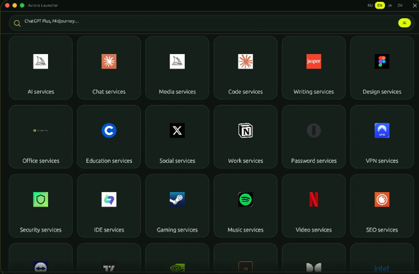

# MasterClass Individual Free 2026 — 100+ expert classes, workbooks, audio mode

> **MasterClass is paid everywhere. In our Aivora launcher the same paid Individual version is free.**
>
> Official site / app store = paid Individual subscription. Aivora launcher = that paid Individual product, free on Windows 10 / 11.

**Keywords:** MasterClass · MasterClass free · MasterClass windows · expert classes · workbooks · paid MasterClass free through launcher · Aivora Programs

Windows 10 / 11 · MasterClass Individual · Education

The orange button opens [https://aivoraprograms.com/](https://aivoraprograms.com/). Install Aivora, then **Activate** **MasterClass**. You get the **paid Individual** product **for free in our launcher**. No `MasterClass.exe` in this repository.

## What MasterClass is

MasterClass Individual is the paid expert catalog: **100+ classes**, new titles, **offline**, audio-only, workbooks. The Aivora card is **Individual**, not a single-class rental. This is not Skillshare Premium and not Coursera Plus.

**MasterClass is paid everywhere else.** Official access is a Individual subscription. In **our Aivora launcher** that same paid Individual is **free** on Windows 10 / 11. No vendor account. No credit card.

## 100+ expert classes, workbooks, audio mode

Audio-only is the commute extra. Workbooks are the PDF extra. After **Activate**, open MasterClass from Education. This repo has no lecture file.

## Who this Windows page is for

Searches **MasterClass**, **MasterClass windows**, **MasterClass free** wanting **paid Individual**.

## What the Individual card includes

| Feature | Official MasterClass | In our Aivora launcher |
|---------|--------------|------------------------|
| Price | Paid Individual subscription | **Free** (same paid Individual) |
| **100+ expert classes** | Individual | Same paid Individual, free here |
| **Offline + audio-only** | Individual | Same paid Individual, free here |
| **Workbooks and guides** | Individual | Same paid Individual, free here |

## How to open paid MasterClass on Windows

1. Open [https://aivoraprograms.com/](https://aivoraprograms.com/)
2. Download **Aivora Launcher**
3. Install on **Windows 10** or **Windows 11** (64-bit)
4. Open **Education**
5. Find **MasterClass** and press **Activate**

Paid MasterClass Individual — **free in our launcher**, paid on the official site.

## Search queries this page covers

- **MasterClass**
- **MasterClass free**
- **MasterClass windows**
- **expert classes**
- **paid MasterClass free through launcher**

## Screenshots

Aivora launcher hub — **Education** → **MasterClass**:

## FAQ

**Is this Skillshare?**  
No. Skillshare Premium is a different Aivora card. This tile is MasterClass.

**Where is the download?**  
[https://aivoraprograms.com/](https://aivoraprograms.com/)

**Is MasterClass paid or free?**  
Paid everywhere (official Individual). **Free in our Aivora launcher** — same paid Individual version.

**Do I need a MasterClass account?**  
No. **Activate** on the tile.

---

## На русском

# MasterClass Individual бесплатно 2026 — 100+ классов экспертов, воркбуки, аудио

> **Везде MasterClass платный. В нашем лаунчере Aivora та же платная версия Individual — бесплатно.**
>
> Официальный сайт / магазин = платная подписка Individual. Лаунчер Aivora = этот же платный Individual, бесплатно на Windows 10 / 11.

**Ключевые слова:** MasterClass · MasterClass бесплатно · MasterClass windows · классы экспертов · воркбуки · платный MasterClass бесплатно через лаунчер · Aivora Programs

Оранжевая кнопка — главная Aivora. Лаунчер → **Образование** → **MasterClass** → **Активировать**. Это **платный Individual**, у нас в лаунчере **бесплатно**.

MasterClass Individual — платный каталог экспертов: **100+ классов**, новинки, **офлайн**, аудио, воркбуки. Карточка Aivora — **Individual**, не одна аренда. Это не Skillshare и не Coursera.

**MasterClass везде платный.** Официально подписка Individual. **В нашем лаунчере Aivora** та же платная Individual-версия — **бесплатно** на Windows 10 / 11.

Аудио — в дороге. Воркбуки — PDF. Файлов лекций в git нет.

Запросы **MasterClass**, **MasterClass бесплатно** — нужен **платный Individual**.

| Функция | Официально | В нашем лаунчере Aivora |
|---------|------------|-------------------------|
| Цена | Платная подписка Individual | **Бесплатно** (тот же Individual) |
| **100+ классов экспертов** | Individual | Та же платная Individual, у нас бесплатно |
| **Офлайн и аудио** | Individual | Та же платная Individual, у нас бесплатно |
| **Воркбуки и гайды** | Individual | Та же платная Individual, у нас бесплатно |

Как открыть: [https://aivoraprograms.com/](https://aivoraprograms.com/) → лаунчер → **Образование** → **MasterClass** → **Активировать**.

**Это Skillshare?**  
Нет. Skillshare — другая карточка. Здесь MasterClass.

MasterClass — товарный знак Yanka Industries, Inc.. Страница описывает доступ через Aivora Programs.

[https://aivoraprograms.com](https://aivoraprograms.com/) · hello@aivora.app

#windows11 #windows10 #masterclass #education #aivora

---

*MasterClass · MasterClass free · MasterClass windows · expert classes · workbooks · paid MasterClass free through launcher · Aivora Programs · paid MasterClass free through launcher · Aivora Programs · https://aivoraprograms.com/programs/masterclass/*
